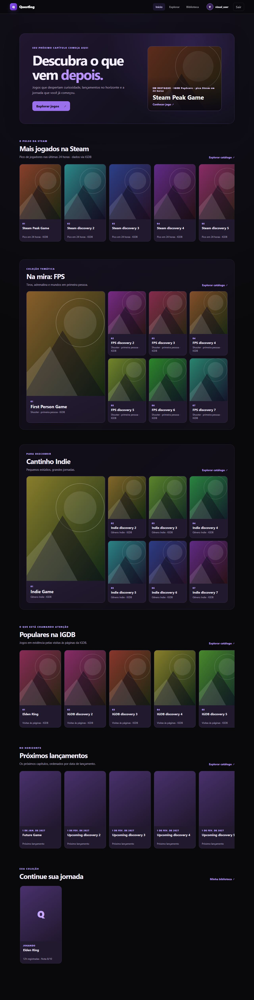
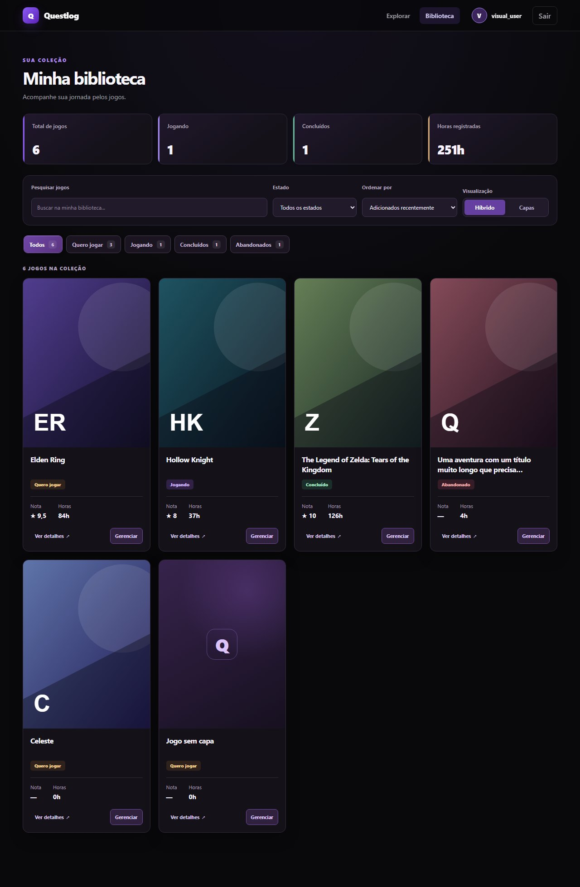

# Questlog

A full-stack game backlog tracker: search the IGDB catalog, build a personal library, rate and review what you play.

**Stack:** Java 21 · Spring Boot · PostgreSQL · Redis · React 19 · TypeScript · Vite

| Home / discovery | Library |
|---|---|
|  |  |

## What it does

- **Accounts** – registration and login with JWT, BCrypt, a password policy and a Pwned Passwords (k-anonymity) check. Usernames are unique regardless of letter case.
- **Catalog and discovery** – IGDB search and import, a discovery home (popular, upcoming, thematic collections) and game pages with screenshots and trailers.
- **Personal library** – status, rating and hours per game, filters, sorting, and a "living shelf" layout.
- **Reviews** – written reviews tied to library entries, plus Steam review summaries.
- **Profile** – unique nickname and an avatar that is re-encoded server-side.

## Engineering highlights

- Flyway migrations with `ddl-auto: validate`; race-safe IGDB import (`ON CONFLICT DO NOTHING`).
- Ownership enforced in queries (`findByIdAndUser_Id`), so other users' data answers 404.
- Bucket4j rate limiting on Redis for auth endpoints, failing closed when Redis is unavailable.
- Redis caching with per-cache TTLs; explicit timeouts on every outbound HTTP client.
- CI on every PR: backend tests against real PostgreSQL and Redis, frontend lint/build/unit tests, CodeQL and gitleaks.
- 140+ backend JUnit tests, frontend unit tests and Playwright end-to-end specs.
- Written security audit with its residual risks: [`docs/security-audit-2026-10.md`](docs/security-audit-2026-10.md). More notes per feature live in [`docs/`](docs/).

## Architecture

```text
React (Vite)  ──HTTP/JSON──▶  Spring Boot API  ──▶  PostgreSQL
                                   │
                                   ├──▶ Redis (cache, rate limits)
                                   └──▶ IGDB / Twitch, Steam, Pwned Passwords
```

```text
backend/    Spring Boot API (auth, user, game, library, review, igdb, discovery, steam, ratelimit)
frontend/   React + TypeScript app (pages, components, api, hooks, styles, e2e)
docs/       Feature notes, security audit, screenshots
```

## Running locally

Requirements: Java 21, Docker, Node.js and npm.

```bash
git clone https://github.com/gothsins/questlog.git
cd questlog
cp .env.example .env        # then fill in the values below
docker compose up -d        # PostgreSQL + Redis
```

Environment variables for the backend (`.env.example` lists them all):

| Variable | Purpose |
|---|---|
| `JWT_SECRET` | Base64 secret with at least 32 random bytes. The app refuses to start without a valid one. Generate with `openssl rand -base64 32`. |
| `JWT_EXPIRATION` | Token lifetime in milliseconds (default `3600000`). |
| `IGDB_CLIENT_ID`, `IGDB_CLIENT_SECRET` | Twitch application credentials, needed for catalog search and import. |

Start the backend:

```bash
cd backend
./mvnw spring-boot:run      # Windows: .\mvnw.cmd spring-boot:run
```

Start the frontend:

```bash
cd frontend
echo "VITE_API_URL=http://localhost:8080" > .env
npm install
npm run dev                 # http://localhost:5173
```

## Tests

```bash
cd backend && ./mvnw test                 # unit and integration tests (needs Docker services)
cd frontend && npm run lint && npm test   # lint and unit tests
cd frontend && npm run test:e2e           # Playwright end-to-end
```

## API documentation

With the backend running, Swagger UI is available at `http://localhost:8080/swagger-ui.html`.
